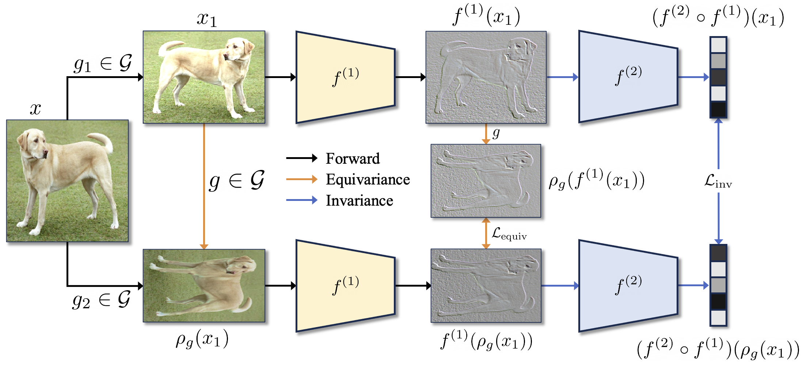

# Soft Equivariance Regularization for Invariant Self-Supervised Learning

  

# Disclaimer
This repo is tested under Python 3.9, PyTorch 2.6.0 + CUDA 11.8, ruamel-yaml 0.17.36, kornia 0.8.0

## Evaluation

See [evaluation setup, CPU checks, and reproducibility status](docs/evaluation.md)
for the linear-probe configuration and the distinction between released training
transforms and the still-unreleased Table 4 equivariance evaluator.
